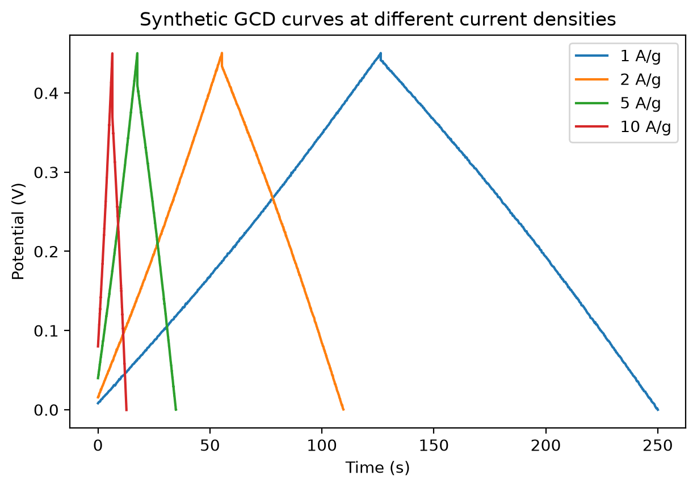

# Electrochemical Analysis of Supercapacitor Electrodes in Python

Python workflow for analysing cyclic voltammetry (CV), galvanostatic
charge-discharge (GCD) and electrochemical impedance spectroscopy (EIS)
data of supercapacitor electrodes.

## Background
I carried out these measurements during my MS thesis on cobalt oxide,
PEDOT and graphene oxide electrodes for supercapacitors. This repository
shows how I analyse such data in Python.

## About the data
The notebooks use synthetic data generated in Python, so that the
analysis can be checked against known values. Experimental data from my
thesis will be added after the associated manuscript is published.

## Contents
- notebooks/01_CV_analysis.ipynb: CV curves and specific capacitance
- notebooks/02_GCD_analysis.ipynb: GCD curves, capacitance, energy and power density
- notebooks/03_EIS_fitting.ipynb: Nyquist plot 

## How to run
1. Install the packages: pip install -r requirements.txt
2. Open Jupyter: jupyter notebook
3. Open a notebook from the notebooks folder and run all cells.

## Skills shown
Python (numpy, pandas, matplotlib, scipy), electrochemical data analysis,
equivalent circuit fitting, scientific plotting.

## Next steps
- Add experimental data after publication
- Learn battery modelling methods

## Author
Sunaina Naveed, MS Nanoscience and Engineering, International Islamic University, Islamabad.